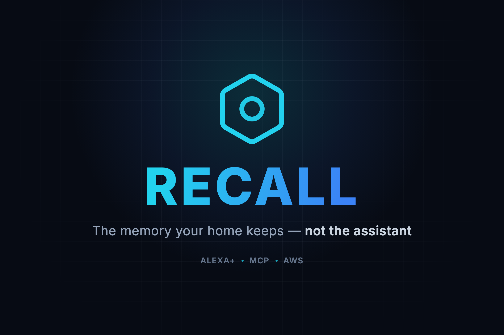
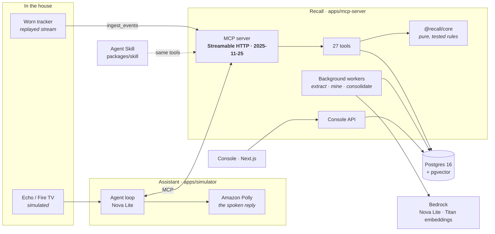
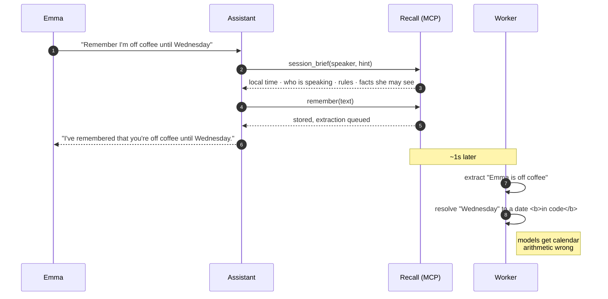

# Recall



**A memory layer for Alexa+ that the household owns.** Per-person, inspectable, correctable,
erasable — and consistent across every device in the house.

Alexa+ forgets. Ask it something personal twice and you can get two different answers, and whatever
it does remember, everyone on the account can see. Recall is the other half: a memory the people in
the house can read, correct and delete, served to the assistant over MCP so it never touches the
database itself.

| | |
|---|---|
| **Track** | Alexa+ — self-hosted MCP server (spec `2025-11-25`, Streamable HTTP), **and** an Agent Skill, **and** a simulated Alexa+ experience |
| **Mini challenges** | AWS Builder |
| **Licence** | MIT |
| **Live console** | https://6gpwq7kegp.us-east-1.awsapprunner.com |
| **Live MCP endpoint** | `https://v9d346pzw7.us-east-1.awsapprunner.com/mcp` |

---

## For judges: sign in without an email

The console is at **https://6gpwq7kegp.us-east-1.awsapprunner.com/sign-in**. Under the email form
there are three one-click buttons — **no credentials needed**:

| Seat | What they see |
|---|---|
| **Emma** (owner) | The household's memory, and her own |
| **Daniel** (adult) | The same household memory — and none of Emma's |
| **Nina** (caregiver) | Only Ruth, and only what her grants allow |

**The fastest 30 seconds:** sign in as Emma, open **Simulator**, ask *"what do you know about me?"*.
Then sign in as Daniel and ask the same thing. The difference between those two answers is the
product.

Everyone in that household is invented and so is everything they said. The sign-in is scoped to the
demo household by its id — there is no input that can point it at a real account
([`console-auth.service.ts`](apps/mcp-server/src/auth/console-auth.service.ts)).

---

## How it works



**The assistant never reaches the database.** It asks for a session brief and gets back only what
this speaker is allowed to know. Everything that decides *what is allowed* is a pure function in
[`packages/core`](packages/core/src), so it is tested rather than prompted.

### One turn, in full



---

## Track requirement, at runtime

The rules ask that the required technology is *imported and actually called*, not named in a README.
It is satisfied three separate ways:

| Requirement | Where | What to look at |
|---|---|---|
| **Self-hosted MCP server**, spec 2025-11-25, Streamable HTTP | [`mcp.controller.ts`](apps/mcp-server/src/mcp/mcp.controller.ts) | Imports `StreamableHTTPServerTransport`; a fresh stateless server per request |
| **27 tools registered** | [`mcp/tools.ts`](apps/mcp-server/src/mcp/tools.ts) | `McpServer` from the SDK, bound to the caller's household |
| **MCP client actually calling it** | [`simulator/src/recall.ts`](apps/simulator/src/recall.ts) | Imports `Client` + `StreamableHTTPClientTransport` |
| **Loaded MCP config** | [`.mcp.json`](.mcp.json) | Claude Code loads this repo's server directly |
| **Agent Skill** | [`packages/skill/SKILL.md`](packages/skill/SKILL.md) | The same tools, as a skill |
| **Simulated Alexa+, source included** | [`apps/simulator`](apps/simulator) | The web experience in the video |

Verify the protocol version yourself:

```sh
curl -s -X POST https://v9d346pzw7.us-east-1.awsapprunner.com/mcp \
  -H 'content-type: application/json' -H 'accept: application/json, text/event-stream' \
  -H 'Authorization: Bearer <household token>' \
  -d '{"jsonrpc":"2.0","id":1,"method":"initialize","params":{"protocolVersion":"2025-11-25","capabilities":{},"clientInfo":{"name":"check","version":"0"}}}'
# -> "protocolVersion":"2025-11-25"
```

---

## What makes it more than a wrapper

Each of these is a tested rule, not a prompt:

- **Per-person scoping.** The same question answers differently for two people in one room, and an
  unknown voice gets household facts only — never anyone's personal memory.
- **Stated rules are law.** *"No music after 10pm on school nights"* blocks the action and the refusal
  quotes the rule back. Rules outrank anything learned.
- **Forgetting really forgets.** A tombstone every device picks up, the words erased where they were
  kept, and snapshots rewritten so an offline device cannot resurrect it.
- **Pre-flight before anything costs money.** Venue never used, address that doesn't match what was
  said, a repeat within two hours, an unusual amount — each is a question, asked before acting.
- **It declines to guess.** Two purchases is not a pattern. A dose nobody confirmed is not a dose
  nobody took. "No record" is its own answer, kept apart from "missed".
- **Care mode.** A caregiver's wording, used verbatim. Absence of a check-in is the signal: ask the
  person first, tell the carers only if they still haven't answered.

---

## Connect your own agent

Recall is a hosted MCP server. Point any MCP client at it — nothing to install:

```sh
claude mcp add --transport http recall https://v9d346pzw7.us-east-1.awsapprunner.com/mcp \
  --header "Authorization: Bearer $RECALL_TOKEN"
```

This repo also ships a [`.mcp.json`](.mcp.json) pointing at the same hosted endpoint; set
`RECALL_TOKEN` and your client loads it. Household tokens are issued from the console under
**Settings**.

`GET /health` reports database and model reachability. `GET /metrics/latency` reports p50/p95 per
tool against its budget — both are public:

```sh
curl https://v9d346pzw7.us-east-1.awsapprunner.com/health
```

## Building on it

Everything above runs on AWS; this is only needed to change the code. Node 22+, pnpm 9, Docker, and
either AWS credentials (Bedrock) or [Ollama](https://ollama.com) for a fully offline run.

```sh
cp .env.example .env && pnpm install
pnpm db:up && pnpm db:migrate && pnpm db:seed
pnpm dev && pnpm sim && pnpm console
pnpm test        # 322 tests, on a separate _test database
```

Deploying is one command — [`scripts/deploy.sh`](scripts/deploy.sh) builds, pushes and rolls both
services; [`scripts/seed-prod.sh`](scripts/seed-prod.sh) reseeds the demo from inside the VPC,
without opening the database to anything.

---

## Repository

| Path | What's in it |
|---|---|
| [`apps/mcp-server`](apps/mcp-server) | NestJS: the MCP server, console API, workers, migrations |
| [`apps/simulator`](apps/simulator) | The simulated Alexa+ — agent loop, devices, replays, Polly voice |
| [`apps/console`](apps/console) | Next.js console: memory, rules, routines, actions, context, care |
| [`packages/core`](packages/core) | Every decision as a pure function — access, rules, context, routines, pre-flight |
| [`packages/llm`](packages/llm) | Bedrock (Converse) and Ollama behind one interface |
| [`packages/skill`](packages/skill) | The Agent Skill |

## Submission documents

| Document | |
|---|---|
| [docs/feedback-answers.md](docs/feedback-answers.md) | The five feedback fields, ready to paste |
| [docs/feedback.md](docs/feedback.md) | Product feedback in full, with the feature requests |
| [docs/aws-builder.md](docs/aws-builder.md) | AWS Builder mini challenge — which services, and how |
| [docs/ai-tools.md](docs/ai-tools.md) | Which AI tools were used, building it and inside it |
| [docs/friction-log.md](docs/friction-log.md) | Friction log, in the required format |
| [docs/devpost-story.md](docs/devpost-story.md) | The project story, and the Built-with tags |
| [docs/video-script.md](docs/video-script.md) | The 3-minute demo video, shot by shot |
| [docs/architecture.md](docs/architecture.md) | The system, and a dated log of every decision and why |
| [docs/design.md](docs/design.md) | The problem, the research behind it, and what is deliberately out of scope |
| [docs/demo-script.md](docs/demo-script.md) | The full walkthrough, longer than the video |

## Licence

MIT — see [LICENSE](LICENSE).
